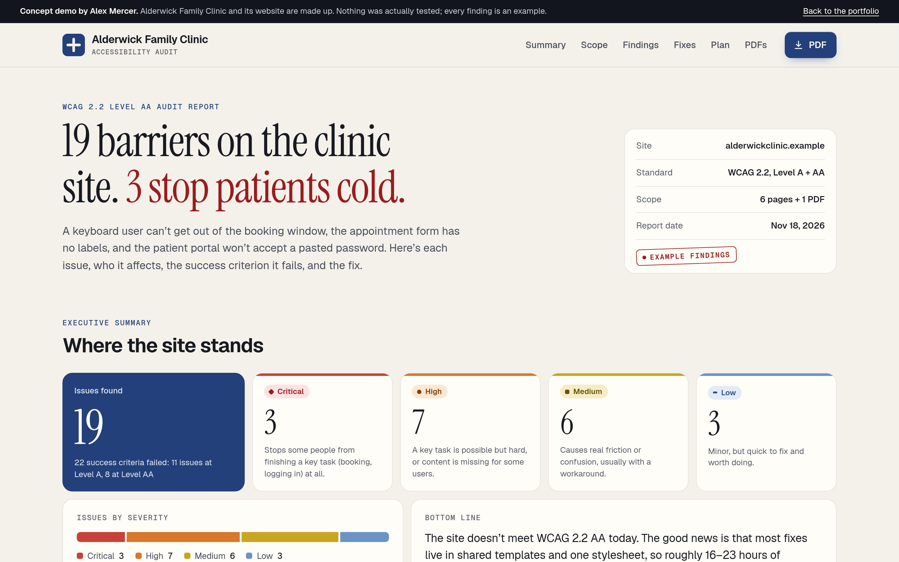

# Alderwick Family Clinic: WCAG 2.2 AA accessibility audit

A sample accessibility audit report for a made-up clinic website. It covers an executive summary with issue counts by severity, the scope and test method, 19 findings mapped to WCAG 2.2 success criteria, before-and-after code for the most common fixes, a remediation plan in priority order, and a note on fixing an inaccessible PDF form.

This is a concept demo. Alderwick Family Clinic and its website don't exist, and nothing was actually tested, so every finding, count and estimate is an example. The success criteria, conformance levels and contrast ratios are real. The ratios come from the WCAG relative-luminance formula in `tools/build.py`.

## View it

Live report: https://alexmercer-projects.github.io/alderwick-accessibility-audit/

Also on the portfolio: https://alexmercer-studio.netlify.app/demos/alderwick-accessibility-audit/

Or open `docs/index.html` in a browser. There is no build step for viewing.

A PDF copy of the whole report is in `docs/Alderwick-accessibility-audit-DEMO.pdf`.



## What's in it

- Executive summary: 19 issues (3 critical, 7 high, 6 medium, 3 low), by severity and by WCAG principle
- Scope and method: six pages and one PDF; automated scan, keyboard pass, screen reader pass, zoom and reflow, contrast, documents and media
- Findings table: success criterion and level, severity, location, who is affected, and the fix. Four findings use criteria that are new in WCAG 2.2 (2.4.11, 2.5.8, 3.2.6, 3.3.8).
- Before and after code: alt text, color contrast with computed ratios, form labels, visible focus, a keyboard trap in a modal, heading structure, link purpose
- Remediation plan: week 1, weeks 2 to 3, within 45 days, and ongoing
- PDF remediation: tagging, reading order, form field names, document properties, and checking

## Screenshots

- [Findings table](screenshots/findings.png)
- [Before and after code](screenshots/fixes.png)
- [Phone view](screenshots/mobile.png)

## The page itself

The report page is meant to pass the checks it describes. It uses semantic headings in order, landmarks, a skip link, a visible `:focus-visible` style, text contrast of at least 4.5:1, and a findings table that works without JavaScript (the severity filter is an add-on). It was checked with axe-core at desktop and phone widths and with a keyboard-only pass. The two "before" contrast swatches are drawn as images of the failing colors on purpose.

## Tech

Plain HTML, CSS and a little vanilla JavaScript in `docs/`. `tools/build.py` generates `docs/index.html` from one findings list, so the counts, charts and table always agree:

```
python3 tools/build.py docs/index.html --standalone
```

Fonts are Geist, Geist Mono and Instrument Serif, self-hosted under the SIL Open Font License (see `docs/fonts/LICENSE.txt`).

## Contact

[alexmercer.projects@gmail.com](mailto:alexmercer.projects@gmail.com)
